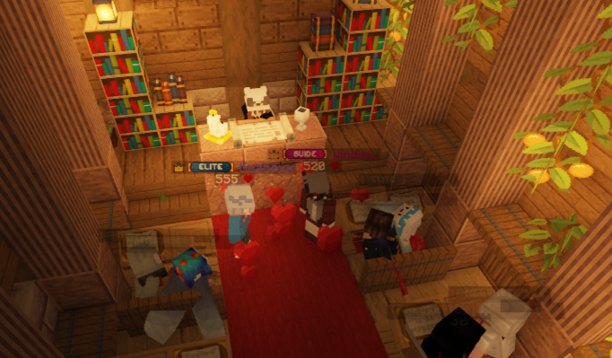

# 💒 Le Mariage

## 💠 <mark style="color:green;">La déclaration 💕</mark>

Pour pouvoir vous marier, il faut d'abord atteindre le <mark style="color:green;">**rang Valeureux**</mark> ! Ensuite, vous pouvez vous marier avec une personne consentante. (Et non monsieur Seguin, vous ne pouvez pas vous marier avec votre chèvre !🐐).

Lorsque le rang est atteint, il faut se diriger vers un <mark style="color:green;">**guide ou plus haut gradé**</mark> afin qu'il puisse vous unir.


Si vous souhaitez <mark style="color:green;">divorcer de votre moitié</mark>, il <mark style="color:green;">faut vous diriger vers un modérateur</mark>.


## 💠 <mark style="color:green;">Les commandes ❔</mark>

- <mark style="color:green;">`/marry request`</mark> -> pour proposer le mariage aux deux personnes (commande réservée aux staffs pour la modération)
- <mark style="color:green;">`/marry accept`</mark> -> pour accepter la demande ✅
- <mark style="color:green;">`/marry decline`</mark> -> pour décliner la demande ❌
- <mark style="color:green;">`/marry kiss`</mark> -> pour embrasser sa moitié 😙
- <mark style="color:green;">`/marry sethome`</mark> -> pour définir le home en commun 🏠
- <mark style="color:green;">`/marry home`</mark> -> pour se téléporter au home 🏠
- <mark style="color:green;">`/marry msg <...>`</mark> -> pour envoyer un message dans le chat du couple 💬

<figure><figcaption></figcaption></figure>
